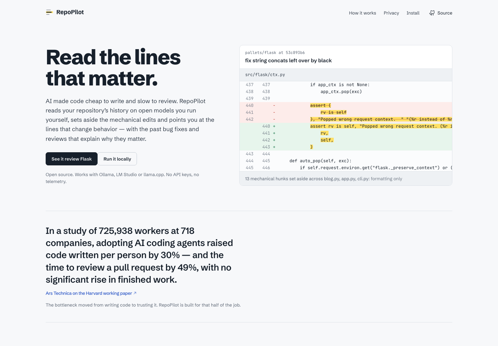
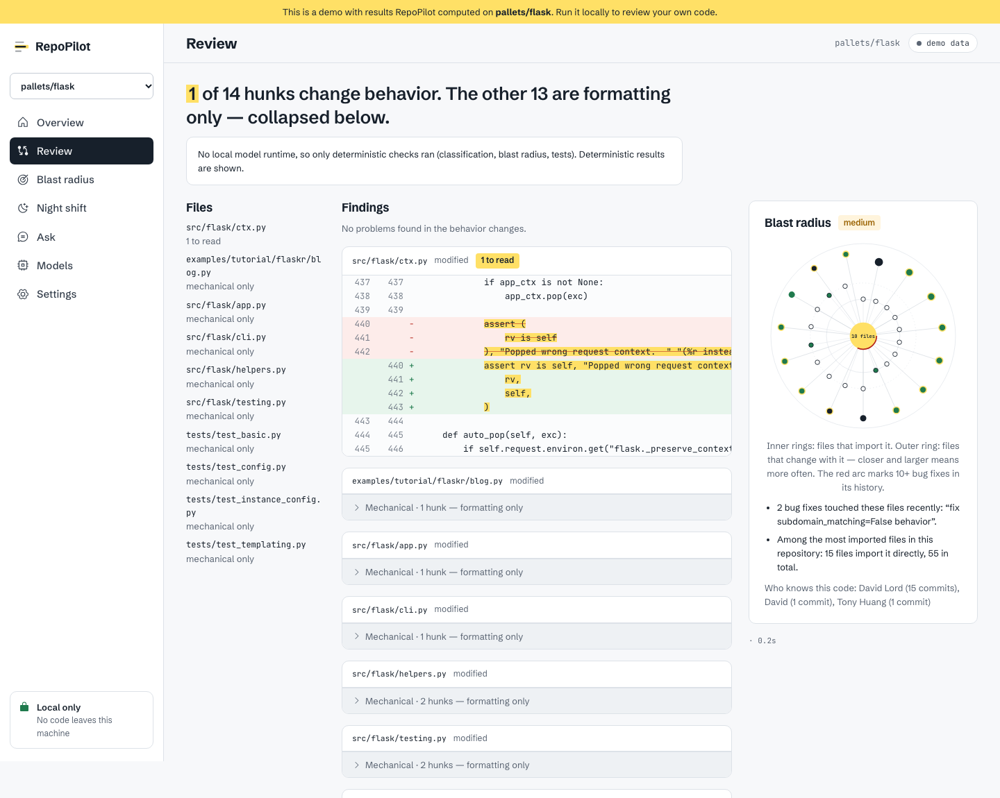
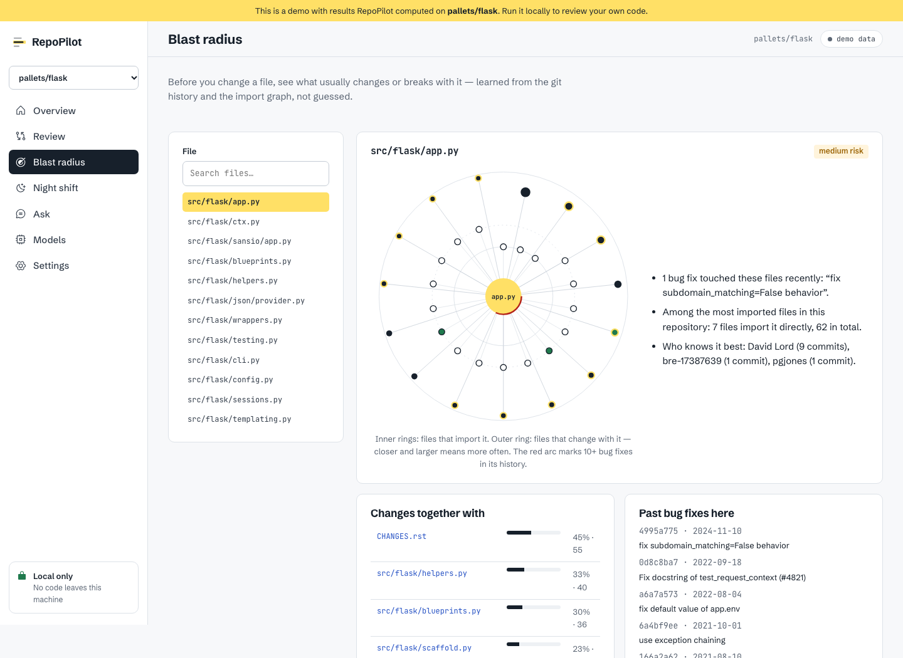

<p align="center"></p>

<h1 align="center">RepoPilot</h1>

<p align="center"><strong>Private, history-aware code review on open models you run yourself.</strong><br>
Sets aside mechanical edits, points you at the lines that change behavior, and explains why they matter using your repository's own history.</p>



## The problem

AI coding tools made code cheap to write and slow to review. A 2026 Harvard working paper covering 725,938 workers at 718 companies found that adopting AI coding agents raised code written per person by 30% — and the time to review a pull request by 49%, with no significant rise in finished work ([Ars Technica](https://arstechnica.com/ai/2026/10/ai-coding-agents-generate-more-code-but-not-more-software/)). The bottleneck moved from writing code to trusting it.

Meanwhile many teams can't send source code to a cloud AI provider at all. RepoPilot runs entirely on your machine — and because it is allowed to read everything, it reads your git history too.

## What it does

| | |
|---|---|
| **Review with memory** | Every change — yours, a teammate's or another AI's — is split into *mechanical* hunks (whitespace, comments, docs, import order, true renames, identical syntax trees) and *behavior* hunks. Behavior is checked against your tests in a throwaway `git worktree`, against past bug fixes and review comments, and by a local model whose findings are discarded if they cite lines outside the change. |
| **Blast radius from history** | For any file: what usually changes with it (co-change mined from commits), what imports it, the bug fixes it has needed, which tests cover it, and who knows it best. Risk is scored relative to *your* repository, not fixed thresholds. |
| **Night shift** | Overnight, reviews each new commit, writes tests for new code — keeping only tests that pass, on a separate branch — and lists docs that mention removed code. Free to run nightly because the models are local. |
| **Which model should we run?** | Replays real past commits from your repository against every installed model and scores whether each change applies, passes your tests and matches what your team wrote, on your hardware. |
| **Verified edits & grounded Q&A** | Edits are applied and tested in a temporary worktree, retried with the failure output, and only shown once they pass. Answers cite exact line ranges; uncited claims are removed; "I couldn't find this in the repository" when the code doesn't say. |

<table><tr>
<td></td>
<td></td>
</tr></table>

## Private by design

- Model calls go only to the runtime **on your machine** — [Ollama](https://ollama.com), LM Studio or a llama.cpp server. No API keys.
- No accounts, analytics or telemetry. Embeddings are stored in a local SQLite file per repository.
- The only optional outbound call is importing public PR review comments from `api.github.com`, off unless `REPOPILOT_ALLOW_GITHUB_IMPORT=1`.
- Without any model runtime, indexing, blast radius, mechanical/behavior review and test checks still work.

Details: [docs/PRIVACY.md](docs/PRIVACY.md).

## Quick start

Requires Python 3.12+ and git. For the model-powered features, a local runtime.

```bash
pipx install "https://github.com/aahil62/repopilot/releases/download/v2.0.0/repopilot-2.0.0-py3-none-any.whl"
ollama pull qwen2.5-coder:7b && ollama pull qwen2.5-coder:1.5b && ollama pull nomic-embed-text
repopilot serve                     # web app at http://127.0.0.1:7341
```

From a terminal inside any git repository:

```bash
repopilot review                    # review uncommitted changes
repopilot blast src/app/payments.py # blast radius of a file
repopilot ask "Why do we retry the payment call?"
repopilot bench                     # which installed model works best on this repo
repopilot nightshift install        # schedule the night shift (prints the command to activate it)
```

RepoPilot picks models that fit your memory; change them with `repopilot models` or the Models page.

## VS Code

Install `repopilot-2.0.0.vsix` from the [releases page](https://github.com/aahil62/repopilot/releases) (*Extensions → … → Install from VSIX*). Commands: **Review Working Changes** (findings in the Problems panel), **Show Blast Radius** (also a CodeLens on every file), **Ask**, **Edit with Verification**, **Pick Models**. See [vscode-extension/README.md](vscode-extension/README.md).

## Measured

From [`eval/run_eval.py`](eval/run_eval.py) on [pallets/flask](https://github.com/pallets/flask) at `3.1.0` with the dataset in [`eval/datasets/flask.json`](eval/datasets/flask.json). Current results: [`eval/results/flask-latest.md`](eval/results/flask-latest.md).

The committed results are an **offline run** (no language model): keyword retrieval finds the right file in the top five for 88% of 25 questions, and 54% of the 252 hunks in Flask's last 40 commits are set aside as mechanical. Vector and hybrid retrieval, refusal accuracy, citation validity and the model benchmark are produced by running the same script with local models.

## How it works

```mermaid
flowchart LR
  subgraph Repo[Your repository]
    code[Code] ; git[(Git history)]
  end
  subgraph Memory[Repository memory · SQLite]
    chunks[Symbol-aware chunks + FTS + vectors]
    graph[Import graph]
    hist[Commits, co-change, fix detection, PR links]
    prec[Past fixes & review comments]
  end
  subgraph Engines
    review[Review] ; blast[Blast radius] ; night[Night shift] ; bench[Model bench] ; edit[Verified edits] ; ask[Ask]
  end
  runtime[Local model runtime<br/>Ollama · LM Studio · llama.cpp]
  wt[Temporary git worktrees<br/>tests run here]
  code --> chunks & graph
  git --> hist --> prec
  Memory --> Engines
  Engines <--> runtime
  review & edit & night & bench --> wt
  Engines --> web[Web app] & vsc[VS Code] & cli[CLI]
```

Design notes: [docs/ARCHITECTURE.md](docs/ARCHITECTURE.md).

## Development

```bash
cd backend && python3.12 -m venv .venv && .venv/bin/pip install -e ".[dev]"
../scripts/check_backend.sh         # ruff + 66 tests (no model or network needed)
cd ../web && npm ci && npm test && npm run dev    # UI on :7342 against the API on :7341
python scripts/bundle_web.py        # build the UI into the wheel
python scripts/build_demo.py        # regenerate the public demo data from a real run on Flask
```

## Limits

- Small local models miss subtle bugs; review quality depends on the model you run. RepoPilot narrows what you read and checks what it can — it does not replace a human reviewer.
- Co-change and fix detection are heuristics over commit history; repositories with squashed or very large commits give weaker signals.
- Tests run with your project's own environment; if dependencies aren't installed, checks will fail for reasons unrelated to the change.
- Import resolution covers Python and JavaScript/TypeScript.

## Credits

RepoPilot began at the AlphaByte 3.0 hackathon as a team project ([CREDITS.md](CREDITS.md)). Version 2 — the local runtime layer, repository memory, history-aware review, blast radius, night shift, model benchmark, verified edits, web app and extension — is a solo rebuild by Aahil Sayed.

MIT licensed.
